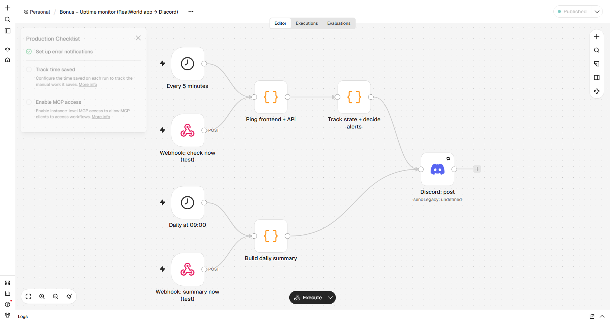

# Bonus – Uptime monitor

Pings the Task 1 app (frontend `http://web:8080/` and API `http://api:3000/api/tags`) **every 5 minutes**, records the **status code and response time**, and posts to the same Discord channel as Task 2.



| Feature | How |
|---|---|
| Check | Code node calls each URL with a 10 s timeout. Healthy = HTTP 200; anything else, a timeout, or a connection error = failed. (Code node rather than HTTP Request node, because the HTTP Request node can't report response time.) |
| Retry logic | Alert only after **2 failed checks in a row**. One blip (a restart, a slow response) is ignored, and a real outage still alerts within 5–10 minutes. 3 in a row would delay alerts to 15 minutes. |
| Alerts | `🔴 API is DOWN (…): getaddrinfo ENOTFOUND api, failed 2 checks in a row.`, sent once per outage, then `🟢 API recovered (…): HTTP 200 in 116 ms after 1 min down.` |
| Daily summary | 09:00 every day: uptime %, average and p95 response time (successful checks), and incident count per target for the last 24 h. |
| State | Workflow static data (`$getWorkflowStaticData`), keeping 48 h of checks. No extra database or sheet needed. |
| Test triggers | `POST /webhook/uptime-check` and `POST /webhook/uptime-summary` run the same nodes on demand, so the demo doesn't need to wait 10 minutes. |

**Networking:** n8n and the app run in the same Docker Compose network, so the monitor uses service names (`web`, `api`). If the app ran directly on the host instead, the URLs would be `http://host.docker.internal:8080`. The Vite preview server only answers requests addressed to `localhost` by default, so Compose adds `web` to its allowed hosts. Without that, the monitor saw HTTP 403 and reported a false outage. That was found and fixed during testing.

**Prove it (outage drill):**
```bash
curl -X POST localhost:5678/webhook/uptime-check        # healthy: nothing posted
docker compose stop api
curl -X POST localhost:5678/webhook/uptime-check        # 1st failure: nothing posted
curl -X POST localhost:5678/webhook/uptime-check        # 2nd failure: 🔴 DOWN
docker compose start api; sleep 25
curl -X POST localhost:5678/webhook/uptime-check        # 🟢 recovered
curl -X POST localhost:5678/webhook/uptime-summary      # 📊 summary
```
Leave about 10 s between checks. In real use checks are 5 minutes apart; when fired back-to-back in under 5 seconds, overlapping runs can read state before the previous run saved it (seen during testing).
