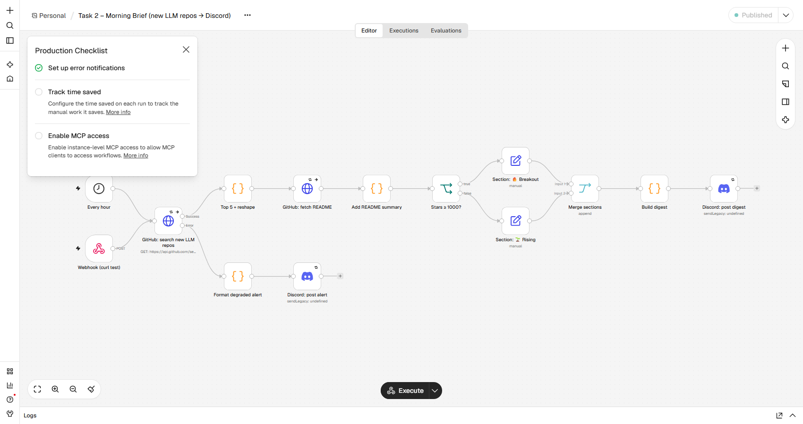

# Task 2 – n8n "Morning Brief"

Every hour (or on demand via webhook) the workflow finds the most-starred **new GitHub repos tagged `llm` from the last 7 days**, adds a one-line summary from each README, splits them into **🔥 Breakout** and **🌱 Rising**, and posts one digest to **Discord**.



## APIs and why
| Step | API | Why |
|---|---|---|
| 1st HTTP Request | `GET api.github.com/search/repositories?q=topic:llm created:>{7 days ago}&sort=stars` | Free, no key needed, stable, and relevant to an AI team. 1 call/hour is far under the 10/min unauthenticated search limit. |
| 2nd HTTP Request (enrichment) | `GET api.github.com/repos/{owner}/{repo}/readme` with `Accept: application/vnd.github.raw` | Second endpoint of the same API. The raw header returns plain markdown, so there's no base64 decoding step. 5 calls/hour vs a 60/hour limit. |
| Output | Discord webhook (Discord node, **Credentials store**) | Free, instant, and the URL is stored only as an n8n credential (`Discord webhook`), never inside a node. |

## What the transformation does
- **Top 5 + reshape (Code):** sorts by stars, keeps 5, and outputs `{name, url, stars, language, description, created_at}`. Missing language becomes `n/a`; a missing description becomes `No description`. Zero results throws on purpose: 0 new `llm` repos in a week means something is wrong, so the Error Workflow is triggered.
- **Add README summary (Code):** strips code blocks, HTML, badges and images, then keeps the first real sentence (max 160 characters).
- **IF `stars ≥ 1000`:** splits into Breakout and Rising; a **Merge** joins them back into one digest. Why 1000: on 9 Nov 2026, 3,854 repos were created with this topic in 7 days. The top star counts were 1587, 280, 154, 95, and then a flat cluster at ~54 (likely bought stars). 1000 is crossed about once a week, so "Breakout" stays rare and meaningful.
- **Build digest (Code):** one Discord message, kept under Discord's 2000-character limit.

## How the error path behaves
| Failure | What happens | Proven by |
|---|---|---|
| GitHub search fails (rate limit, 5xx, timeout) | 3 tries, 2 s apart. Then the node's **error output** → `⚠️ Morning brief degraded: … failed after 3 tries with 404 / …` is posted. Nothing fails silently. | `test-failures.sh` (search-fail) |
| A README call fails | **Graceful degradation**: the run continues and uses the GitHub description, and the digest ends with `⚠️ README unavailable for N repo(s)…` | `test-failures.sh` (readme-fail) |
| Anything unexpected (bug, 0 results, Discord down) | The workflow's **Error Workflow** (`Task2_ErrorHandler_SakshiDesai.json`, Error Trigger) posts `🚨 Workflow crashed: <name> / Node / Error / Execution id` | `test-failures.sh` (crash) |
| Discord rejects a post | 3 tries; then the Error Workflow. If Discord itself is down, the alert can't reach Discord either, so the failed execution is still listed in n8n → Executions. | – |

## Run it
```bash
cp .env.example .env               # fill DISCORD_WEBHOOK_URL (+ the local passwords)
docker compose up -d --build       # n8n on http://localhost:5678 (+ the Task 1 app)
bash n8n-setup.sh                  # loads the webhook into n8n Credentials, imports + publishes all workflows
bash task2-n8n-workflow/test-webhook.sh     # happy path: expect HTTP 200 + PASS
bash task2-n8n-workflow/test-failures.sh    # the 3 failure paths above
```
Importing by hand works too: n8n → Workflows → Import from file, then create a **Discord Webhook** credential named `Discord webhook`.
